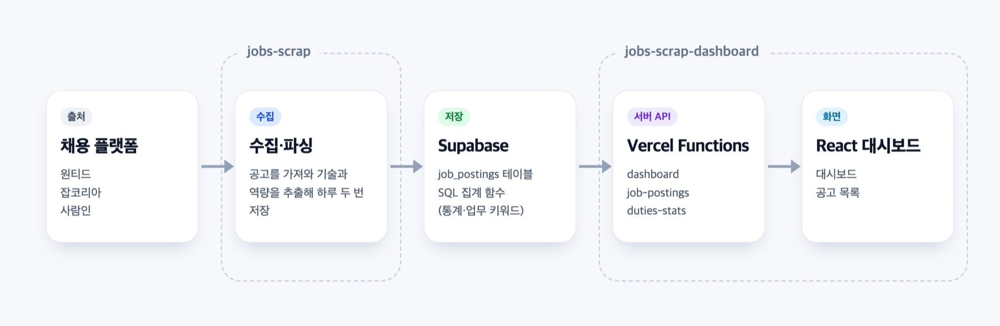
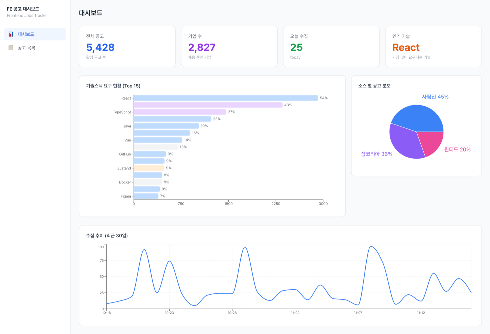
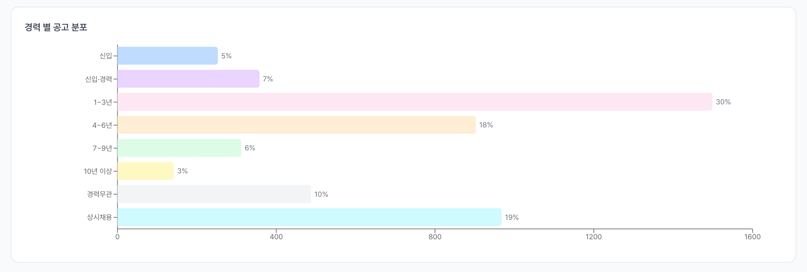
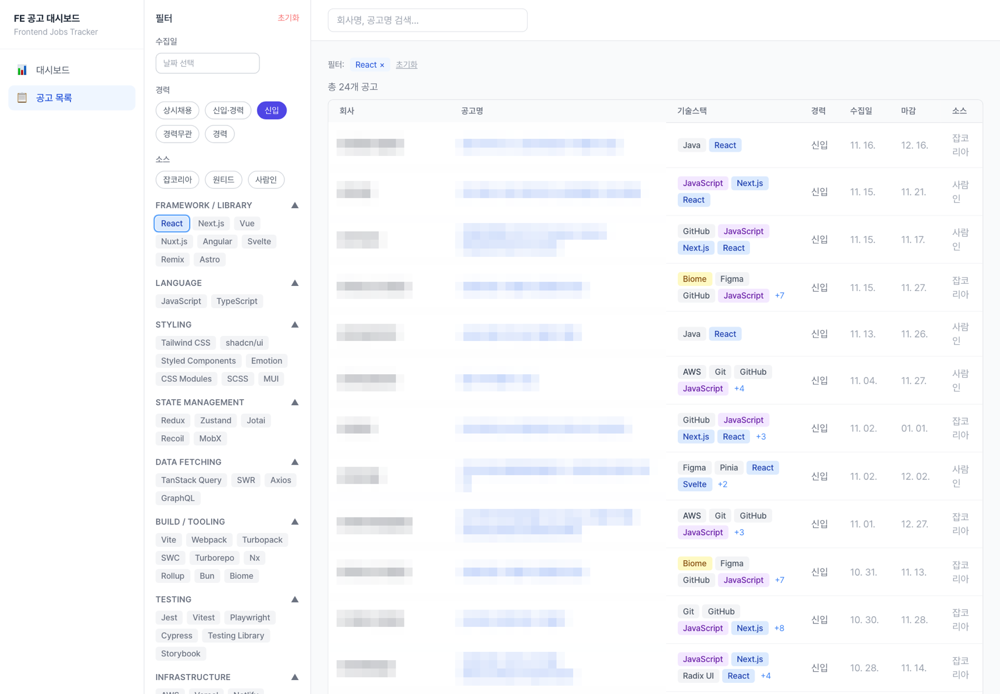

```json
{
  "schemaVersion": 1,
  "slug": "jobs-scrap-dashboard",
  "title": "프론트엔드 채용 데이터 대시보드",
  "description": "수집해 둔 프론트엔드 채용 공고를 Supabase에서 집계해 기술 스택·경력·주요 업무 흐름을 한 화면에 보여 주고, 필터와 검색으로 공고를 좁혀 보는 React 대시보드입니다.",
  "image": "https://raw.githubusercontent.com/side-projects-labs/jobs-scrap-dashboard/b6e47d448a565ea3001478632ca44e165fbe6551/PROJECT.png",
  "stacks": [
    "React",
    "TypeScript",
    "Vite",
    "Tailwind CSS",
    "React Router",
    "Recharts",
    "Supabase",
    "Vercel",
    "Groq"
  ],
  "linkDemo": "https://scrap.ycseng.com",
  "linkGithub": "https://github.com/side-projects-labs/jobs-scrap-dashboard"
}
```

# 프론트엔드 채용 데이터 대시보드

## 목차

- [🧭 쌓아 둔 공고를 읽는 화면으로](#-%EC%8C%93%EC%95%84-%EB%91%94-%EA%B3%B5%EA%B3%A0%EB%A5%BC-%EC%9D%BD%EB%8A%94-%ED%99%94%EB%A9%B4%EC%9C%BC%EB%A1%9C)
- [📊 숫자로 보는 채용 흐름](#-%EC%88%AB%EC%9E%90%EB%A1%9C-%EB%B3%B4%EB%8A%94-%EC%B1%84%EC%9A%A9-%ED%9D%90%EB%A6%84)
- [🔎 조건에 맞는 공고만 좁혀 보기](#-%EC%A1%B0%EA%B1%B4%EC%97%90-%EB%A7%9E%EB%8A%94-%EA%B3%B5%EA%B3%A0%EB%A7%8C-%EC%A2%81%ED%98%80-%EB%B3%B4%EA%B8%B0)
- [💾 집계는 DB에서 호출은 서버에서](#-%EC%A7%91%EA%B3%84%EB%8A%94-db%EC%97%90%EC%84%9C-%ED%98%B8%EC%B6%9C%EC%9D%80-%EC%84%9C%EB%B2%84%EC%97%90%EC%84%9C)
- [🤖 주요 업무 키워드와 대체 경로](#-%EC%A3%BC%EC%9A%94-%EC%97%85%EB%AC%B4-%ED%82%A4%EC%9B%8C%EB%93%9C%EC%99%80-%EB%8C%80%EC%B2%B4-%EA%B2%BD%EB%A1%9C)

채용 공고를 모아 두기만 하면 데이터가 아니라 더미에 가깝습니다. jobs-scrap이 원티드·잡코리아·사람인의 프론트엔드 공고를 Supabase에 쌓기 시작하자 다음 질문은 자연스럽게 "그래서 지금 시장은 무엇을 요구하는가"가 되었습니다. 이 프로젝트는 그 질문에 한 화면에서 답하려고 만든 대시보드입니다.

## 🧭 쌓아 둔 공고를 읽는 화면으로

수집기는 하루에 두 번 공고를 가져와 Supabase에 쌓습니다. 데이터가 늘어날수록 공고 한 건을 열어 보는 일보다 "지금 어떤 기술이 많이 요구되는가", "신입을 받는 곳은 어디인가" 같은 질문이 더 자주 떠올랐습니다. 목록만으로는 이 질문에 답하기 어려워서 쌓인 데이터를 한눈에 읽는 화면을 따로 만들었습니다.

수집과 표시는 저장소를 나눴습니다. [jobs-scrap](https://github.com/side-projects-labs/jobs-scrap)이 공고를 가져와 저장하고 이 프로젝트는 저장된 데이터를 조회해 보여 주는 일만 맡습니다. 화면은 두 가지로, 대시보드는 전체 흐름을 요약하고 공고 목록은 조건에 맞는 공고를 표로 보여 줍니다. Vite 위의 React와 TypeScript로 만들었고 라우팅은 React Router, 스타일은 Tailwind CSS, 차트는 Recharts를 사용했습니다.



*공고가 수집기를 거쳐 Supabase에 저장되고 이 프로젝트의 서버 API를 통해 화면에 도달하는 흐름을 정리한 도식입니다. 주요 업무 키워드는 Groq LLM을 거치며, 호출이 실패하면 서버가 직접 추출해 대체합니다.*

## 📊 숫자로 보는 채용 흐름

대시보드의 첫 줄은 지금의 규모를 네 개의 카드로 보여 줍니다. 활성 공고 수, 공고를 낸 기업 수, 오늘 수집된 공고 수, 가장 많이 요구되는 기술입니다. 아래로 내려가며 기술 스택, 출처, 수집 추이, 경력 조건, 주요 업무 키워드를 차례로 확인합니다.



*2026년 11월 16일 기준 실제 대시보드 화면입니다. 활성 공고 5,428건, 채용 기업 2,827곳이 집계되었고 React가 가장 많이 요구되는 기술로 나타납니다.*

기술 스택 차트는 공고 가운데 해당 기술이 언급된 비율을 막대로 보여 줍니다. 출처별 비율 차트는 사람인·잡코리아·원티드의 공고가 어떻게 나뉘는지, 수집 추이 차트는 최근 30일 동안 하루에 몇 건이 들어왔는지 보여 줍니다.

같은 기술도 공고마다 `ReactJS`, `react.js`, `Next`처럼 다르게 적혀 있어서 그대로 세면 하나의 기술이 여러 막대로 흩어집니다. 그래서 표기를 정해진 이름으로 맞춘 뒤 집계합니다. 경력 조건도 `경력3년↑`, `경력3년이상`처럼 제각각이던 표기를 `경력 N년 이상` 한 형태로 통합해 분포를 계산합니다.



*2026년 11월 16일 기준 경력 조건별 공고 분포의 일부입니다. 상시채용, 신입·경력, 신입, 경력무관처럼 표기를 통합한 항목별 비율을 보여 줍니다.*

## 🔎 조건에 맞는 공고만 좁혀 보기

흐름을 본 뒤에는 실제 공고를 확인하고 싶어집니다. 공고 목록은 수집일, 경력, 출처, 기술 스택으로 필터링하고 회사명과 공고명으로 검색할 수 있습니다. 기술 스택 필터는 프레임워크, 언어, 스타일링, 상태 관리처럼 카테고리로 묶어서 고르기 쉽게 했습니다.



*React와 신입 조건을 함께 선택한 목록 화면입니다. 2026년 11월 16일 기준 24건으로 좁혀지고, 적용한 필터는 목록 위에 태그로 표시됩니다.*

적용한 필터는 목록 위에 태그로 남아 하나씩 해제하거나 한 번에 초기화할 수 있습니다. 필터가 바뀌면 1페이지로 돌아가고 표는 20건 단위로 나누어 보여 줍니다. 각 행에는 회사, 공고명, 기술 스택, 경력, 수집일, 마감일, 출처가 함께 나오며 기술 스택이 많은 공고는 일부만 보여 주고 나머지는 개수로 표시합니다.

## 💾 집계는 DB에서 호출은 서버에서

처음에는 브라우저가 Supabase를 직접 조회하고 화면에서 집계했습니다. 이후 통계를 Supabase의 SQL 함수 `get_dashboard_stats`로 옮겨 조회 행 수 제한 없이 DB에서 한 번에 집계하도록 바꿨습니다. 기술 이름을 정규화하는 규칙도 이 함수 안에서 함께 처리합니다.

Supabase 호출은 Vercel 서버리스 함수로 이전했고 대시보드 통계, 공고 목록, 주요 업무 키워드를 각각 별도 API로 나누어 화면이 필요한 데이터만 요청합니다. 공고 목록 데이터는 목록 화면에 들어왔을 때만 불러오도록 Provider의 범위를 줄여, 대시보드를 볼 때는 목록 요청이 일어나지 않습니다. 날짜를 고를 때의 로딩 표시도 목록 영역에만 나타나게 했습니다.

## 🤖 주요 업무 키워드와 대체 경로

기술 스택과 달리 주요 업무는 문장으로 적혀 있어서 바로 셀 수 없습니다. 서버 함수가 업무 문장의 표본을 Groq의 LLM(`qwen/qwen3.8-27b`)에 보내 핵심 키워드를 뽑고 표기가 다른 기술명은 정해진 이름으로 맞춥니다.

외부 서비스가 항상 응답한다고 가정하지 않았습니다. LLM 호출이 실패하면 서버가 정규표현식으로 기술·도구 이름과 한글 키워드를 직접 뽑는 로컬 추출로 대체해서 차트가 비지 않도록 했습니다. 이 차트는 표본 문장을 대상으로 한 추출 결과이므로 정확한 빈도보다는 어떤 업무가 자주 등장하는지 경향을 보는 용도입니다.
